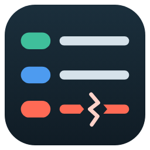
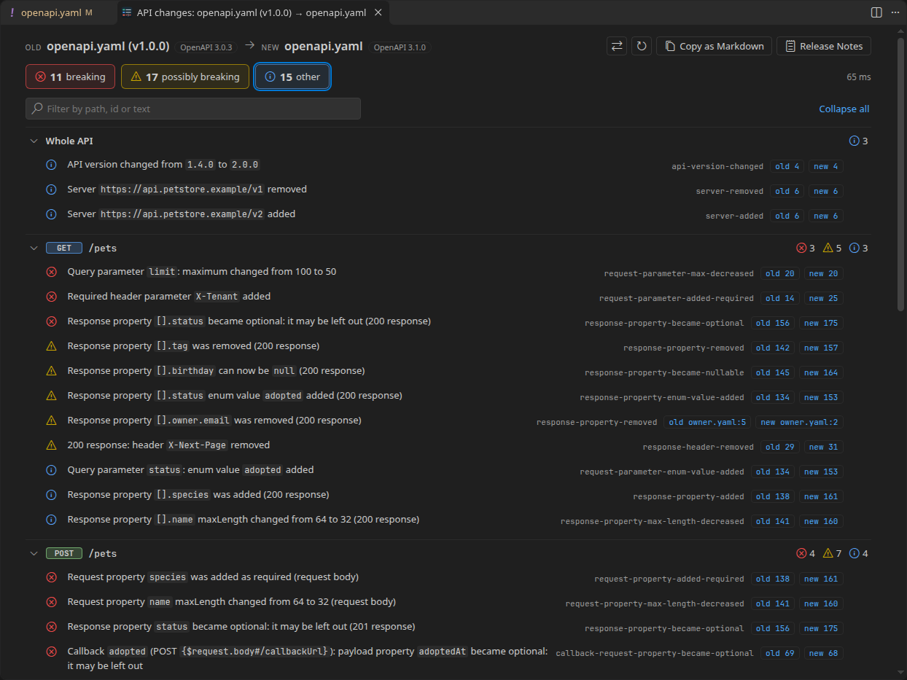
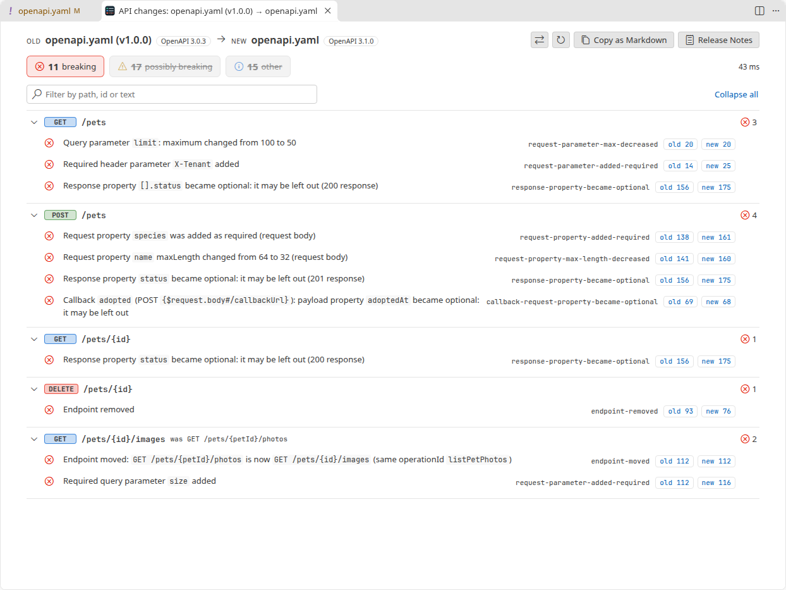
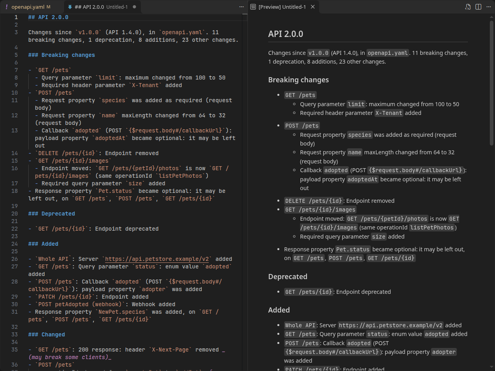
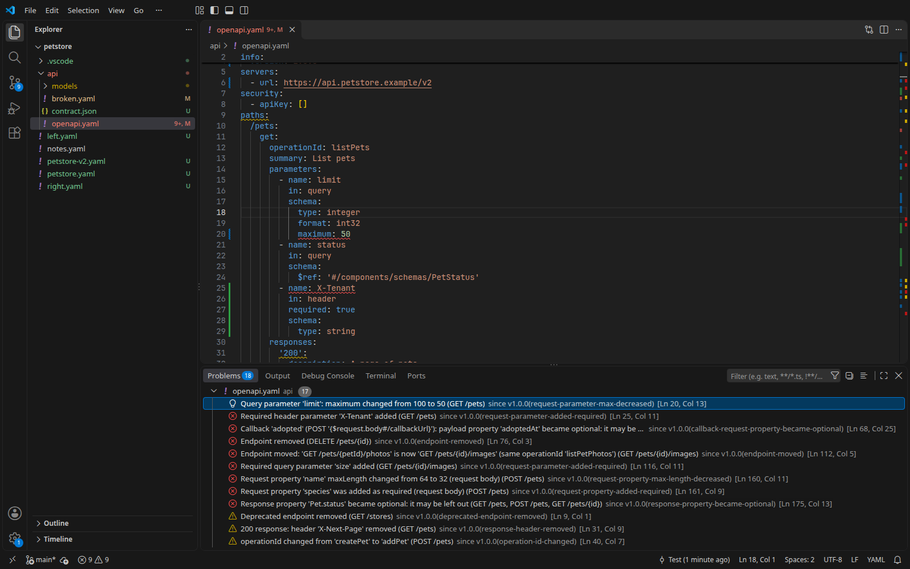

<h1 align="center">
  <br>
  OpenAPI Breaking Changes
</h1>

<p align="center">
  Diff two versions of an OpenAPI or Swagger spec and see what changed for the people who call the API.
</p>

<p align="center">
  <a href="https://github.com/heyliamme/openapi-breaking-changes/blob/main/CHANGELOG.md">Changelog</a> ·
  <a href="https://github.com/heyliamme/openapi-breaking-changes/blob/main/CONTRIBUTING.md">Contributing</a>
</p>



A text diff of an API spec tells you which lines moved. It doesn't tell you that the new
`maxLength: 32` will reject names your clients send today, that a field your mobile app
reads is now optional, or that the `Pet` schema you edited is returned by eleven
endpoints. This extension reads both versions of the spec, follows every `$ref`, and lists
the changes as an API consumer sees them:

- **Breaking**: clients that work today will fail. A removed or moved endpoint, a new
  required parameter, a response field that was removed or became optional, a tighter
  limit on a request.
- **Possibly breaking**: depends on the client. A new enum value in a response (an
  exhaustive `switch` breaks), a removed optional response field, a changed `operationId`
  (generated SDKs rename the method).
- **Other**: everything else consumers can see, such as new endpoints and optional fields.

Direction matters: a new enum value is harmless in a request and possibly breaking in a
response; a tighter `maximum` is breaking in a request and harmless in a response. Each
change is checked from the side it affects, and in callbacks and webhooks, where the API
sends the request, the other way round.

It reads OpenAPI 3.0, 3.1 and 3.2 and Swagger 2.0, in YAML or JSON, including specs split
over many files, and compares across versions too (a Swagger 2.0 spec against its OpenAPI 3
conversion). It runs locally in the editor; nothing is sent anywhere.

## Install

From the [Visual Studio Marketplace](https://marketplace.visualstudio.com/items?itemName=heyliam.openapi-breaking-changes),
from [Open VSX](https://open-vsx.org/extension/heyliam/openapi-breaking-changes) (VSCodium,
Cursor and other editors), or from a terminal:

```bash
code --install-extension heyliam.openapi-breaking-changes
```

## Getting started

Open a spec and press <kbd>Ctrl</kbd>+<kbd>K</kbd> <kbd>B</kbd>
(<kbd>Cmd</kbd>+<kbd>K</kbd> <kbd>B</kbd> on macOS), then pick the branch or
tag to compare with, for example `main` or the tag of the last release.

| To compare | Do this |
| --- | --- |
| Your working copy with the last commit | **Compare with HEAD**, in the editor's context menu under **OpenAPI Breaking Changes** |
| Your working copy with a branch, tag or commit | <kbd>Ctrl</kbd>+<kbd>K</kbd> <kbd>B</kbd>, or **Compare with Git Branch or Tag…** |
| Two releases, for release notes | **Write Release Notes…**: pick the last release, then the new one (or the working copy) |
| The current spec with another file | **Compare with Another Spec…**: lists the OpenAPI files in the workspace |
| Two files in the Explorer | Select both, right-click, **Compare Specs for Breaking Changes**. The old one is told by `info.version`, then by the names (`api-old` / `api-new`, `petstore` / `petstore-v2`); when neither says, you're asked. **⇄** swaps them. |
| The two sides of a diff editor (Source Control, a pull request, Timeline) | The button in the editor title bar, or <kbd>Ctrl</kbd>+<kbd>K</kbd> <kbd>B</kbd> |

Files are recognised as specs by their content (a top-level `openapi` or `swagger` key),
whatever they are called. When the spec references other files (`$ref: ./schemas/pet.yaml`),
those are read at the same version: from the same branch or tag when comparing with Git.

## The report

- **Counts** at the top: breaking, possibly breaking, other, and ignored. Click one to
  hide or show that level.
- **Grouped by endpoint** (`GET /pets/{petId}`), with changes to the whole API (servers,
  version, security schemes) first and webhooks last. Within an endpoint, breaking changes
  come first.
- **Search** by path, change id or text: <kbd>/</kbd> jumps to the box.
- **Click a change**, or the `old 42` / `new 57` buttons, to open the spec at that line.
  A change in a shared schema points at the schema, wherever it is defined.
- **Copy as Markdown** puts a changelog on the clipboard for a pull request. A change to a
  schema that several endpoints share is listed once, by the schema's name, with the
  endpoints.
- **Release Notes** opens the same changes as release notes for consumers (below).
- **Ignore** (the eye on each change) adds a rule to the settings: this change, every
  change of that kind, or everything on that endpoint.

The report follows your edits: change the spec and it updates.



## Release notes

**Write Release Notes…** (in the Command Palette and the editor's context menu) asks for
the last release, offering the latest tag first, and then the new one: the working copy, a
tag, branch or commit. It opens Markdown for the people who use the API, ready to edit and
paste into a release:

```markdown
## API 2.0.0

Changes since `v1.0.0` (API 1.4.0), in `openapi.yaml`. 11 breaking changes, 1 deprecation, 8 additions, 23 other changes.

### Breaking changes

- `DELETE /pets/{id}`: Endpoint removed
- `GET /pets/{id}/images`
  - Endpoint moved: `GET /pets/{petId}/photos` is now `GET /pets/{id}/images` (same operationId `listPetPhotos`)
  - Required query parameter `size` added
- Response property `Pet.status` became optional: it may be left out, on `GET /pets`, `POST /pets`, `GET /pets/{id}`
…

### Deprecated

- `GET /pets/{id}`: Endpoint deprecated

### Added

- `PATCH /pets/{id}`: Endpoint added
- `POST petAdopted (webhook)`: Webhook added
…

### Changed

- Response schema `PetStatus` enum value `adopted` added, on `GET /pets`, `POST /pets`, `GET /pets/{id}` _(may break some clients)_
…
```

Breaking changes come first, then deprecations, then what is new, then everything else,
with possibly breaking changes marked. A change to a schema that several endpoints share
is one line, named by the schema (`Pet.status`). Ignored changes are left out.

The **Release Notes** button in a report does the same for the two sides it compares.



## Breaking changes in the Problems panel

Set `openapiBreakingChanges.baseRef` to the branch or tag your API is released from, and
every open spec is checked against it as you type. Breaking changes show up as problems
on the line that caused them:

```jsonc
// .vscode/settings.json
"openapiBreakingChanges.baseRef": "main"
```



A change in a file the spec references (`$ref: ./models/owner.yaml`) is a problem in that
file, and editing that file checks the spec again. If the ref names no branch, tag or
commit in the repository (a typo, or a branch not fetched yet), a message says so: an
empty Problems panel always means no breaking changes.

A change in a shared schema is one problem, with the endpoints it affects. The quick fix
(<kbd>Ctrl</kbd>+<kbd>.</kbd>) opens the full report or ignores the change.
`openapiBreakingChanges.problemsLevel` chooses which levels appear (by default, breaking
and possibly breaking).

## Moved endpoints

An endpoint that moved to another path (`/pets/{petId}/photos` → `/pets/{id}/images`) is
one breaking change, `endpoint-moved`, that names both paths, instead of a removed endpoint
and an unrelated new one. The changes inside it are compared too, so a parameter added on
the way still shows. It counts as moved when:

- **the same `operationId`** is on both, unique in each spec (the method may differ:
  `POST /search` → `QUERY /search`), or
- **without an `operationId` to go by**, an operation with the same method takes and
  returns nearly the same things: parameters, body and response schemas, status codes,
  tags, summary and the fixed parts of the path (not versions such as `v1`). At least 75%
  of these must match, and
  the match must be clearly the best for both operations. The message says how alike they
  were.

A moved endpoint is still a breaking change, so it never hides a removal: clients calling
the old path fail either way. `openapiBreakingChanges.detectMovedEndpoints` limits the
matching to `operationId` (`"operationId"`) or turns it off (`"off"`).

## Settings

| Setting | Default | |
| --- | --- | --- |
| `openapiBreakingChanges.ignore` | `[]` | Changes to leave out of the counts and the Problems panel. See below. |
| `openapiBreakingChanges.treatWarningsAsErrors` | `false` | Count possibly breaking changes as breaking. |
| `openapiBreakingChanges.detectMovedEndpoints` | `"similar"` | `similar`: by `operationId`, or by what the operation takes and returns; `operationId`: by `operationId` only; `off`: a moved endpoint is removed and added. |
| `openapiBreakingChanges.baseRef` | `""` | Branch, tag or commit to check open specs against in the Problems panel. Empty turns it off. |
| `openapiBreakingChanges.problemsLevel` | `"warning"` | `error`: only breaking changes; `warning`: breaking and possibly breaking; `info`: all. |

Every setting can differ per folder, so a multi-root workspace with several APIs can give
each its own baseline and rules in the folder's `.vscode/settings.json`.

### Ignore rules

```jsonc
"openapiBreakingChanges.ignore": [
  "response-property-enum-value-added",                 // a change id, anywhere
  "*-deprecated",                                       // * matches any run of characters
  { "path": "/internal/**", "reason": "not public" },   // * is one path segment, ** any number
  { "id": "request-parameter-removed", "method": "get", "path": "/search" }
]
```

Ignored changes stay in the report, dimmed and struck through with their reason, and are
left out of the counts, the Problems panel, the Markdown changelog and the release notes.
A moved endpoint matches rules for its old path as well as its new one; a webhook matches
`path` rules by its name.

In [Restricted Mode](https://code.visualstudio.com/docs/editor/workspace-trust) the
workspace's `ignore` and `baseRef` settings are not applied, so a repository you just
cloned can't hide its own breaking changes, and nothing that runs Git starts. Comparing two
files still works there; **Ignore** then offers to put the rule in your user settings.

## Commands

All are under **OpenAPI Breaking Changes** in the Command Palette.

| Command | |
| --- | --- |
| Compare with HEAD | The current spec against its last commit. |
| Compare with Git Branch or Tag… | Pick a branch, tag or remote branch, or type a commit or an expression such as `HEAD~3`. Recently used refs come first, tags newest first. |
| Compare with Another Spec… | Pick another spec in the workspace, or browse. |
| Write Release Notes… | Release notes between two versions of the current spec. |
| Check This Diff for Breaking Changes | The two sides of the active diff editor. |
| Show Changes Since Baseline | The current spec against `openapiBreakingChanges.baseRef`. |

## How levels are chosen

The question is always: does a client that works today, written against the old spec,
still work? Some calls are judgement calls, made on purpose:

- **A removed request property or parameter is possibly breaking**, not breaking. Most
  servers ignore input they don't know, so clients that still send it keep working. If
  yours rejects unknown fields, turn on `treatWarningsAsErrors`.
- **A response property that became optional is breaking.** A client that reads it,
  generated or not, now gets nothing where it always got a value.
- **Looser limits in a response are informational** (a higher `maxLength`, a lower
  `minimum`). Clients rarely validate responses; reporting them as risks would bury the
  ones that matter. Tighter limits in a request are breaking: values accepted today are
  rejected.
- **A new enum value in a response is possibly breaking**: exhaustive `switch`es and
  strict enum decoding break, tolerant clients don't.
- **A changed `operationId` is possibly breaking**: the API still answers the same way,
  but generated SDKs rename the method.
- **Servers added or removed at the top level are informational**: clients usually set
  their base URL themselves. Servers an operation declares for itself are possibly
  breaking when one is removed, since that operation is no longer served there.

## Detected changes

Each change has an id, used in ignore rules and shown in the report and the Problems
panel. Changes inside schemas get a prefix that says where the schema is:
`request-parameter-`, `request-body-`, `request-property-`, `response-body-`,
`response-property-` or `response-header-`. For example, a property removed from a
response is `response-property-removed`, and a query parameter whose `maxLength` went down
is `request-parameter-max-length-decreased`.

#### Endpoints

| Id | Level | Change |
| --- | --- | --- |
| `endpoint-removed` | breaking | An operation (method + path) was removed |
| `deprecated-endpoint-removed` | warning | A deprecated operation was removed |
| `endpoint-moved` | breaking; warning when the operation was deprecated | An operation moved to another path or method (matched by `operationId` or by what it takes and returns) |
| `endpoint-added` | info | An operation was added |
| `endpoint-deprecated` | info | An operation was marked deprecated |
| `endpoint-reactivated` | info | An operation is no longer deprecated |
| `operation-id-changed` | warning | `operationId` changed or was removed (generated clients rename the method) |
| `endpoint-server-added` | info | A server was added to an operation or path (its own `servers`) |
| `endpoint-server-removed` | warning | A server was removed from an operation or path (its own `servers`) |

#### Parameters

| Id | Level | Change |
| --- | --- | --- |
| `request-parameter-added` | info | An optional parameter was added |
| `request-parameter-added-required` | breaking | A required parameter was added |
| `request-parameter-removed` | warning | A parameter was removed (clients still send it) |
| `request-parameter-location-changed` | breaking | A parameter moved, such as from query to header |
| `request-parameter-became-required` | breaking | An optional parameter became required |
| `request-parameter-became-optional` | info | A required parameter became optional |
| `request-parameter-serialization-changed` | warning | `style` or `explode` changed |
| `request-parameter-deprecated` | info | A parameter was marked deprecated |

#### Request body

| Id | Level | Change |
| --- | --- | --- |
| `request-body-added` | info | An optional request body was added |
| `request-body-added-required` | breaking | A required request body was added |
| `request-body-removed` | warning | The request body was removed |
| `request-body-became-required` | breaking | The request body became required |
| `request-body-became-optional` | info | The request body became optional |
| `request-body-media-type-added` | info | A request media type was added |
| `request-body-media-type-removed` | breaking | A request media type was removed |

#### Responses

| Id | Level | Change |
| --- | --- | --- |
| `response-success-status-removed` | breaking | A 2xx response was removed |
| `response-status-removed` | warning | A non-2xx (or `default`) response was removed |
| `response-status-added` | info | A response status was added |
| `response-media-type-added` | info | A response media type was added |
| `response-media-type-removed` | breaking | A response media type was removed |
| `response-header-added` | info | A response header was added |
| `response-header-removed` | breaking when it was required, else warning | A response header was removed |
| `response-header-became-optional` | breaking | A required response header became optional |
| `response-link-added` | info | A response link was added |
| `response-link-removed` | warning | A response link was removed (clients that follow it break) |
| `response-link-changed` | warning | A response link points at another operation or passes other parameters |

#### Callbacks and webhooks

| Id | Level | Change |
| --- | --- | --- |
| `webhook-added` | info | A webhook (OpenAPI 3.1 `webhooks`) was added |
| `webhook-removed` | breaking | A webhook was removed: clients stop receiving it |
| `deprecated-webhook-removed` | warning | A deprecated webhook was removed |
| `webhook-deprecated` | info | A webhook was marked deprecated |
| `webhook-reactivated` | info | A webhook is no longer deprecated |
| `callback-added` | info | A callback was added to an operation |
| `callback-removed` | breaking | A callback was removed: clients stop receiving it |
| `deprecated-callback-removed` | warning | A deprecated callback was removed |
| `callback-deprecated` | info | A callback was marked deprecated |
| `callback-reactivated` | info | A callback is no longer deprecated |
| `callback-url-changed` | breaking | The runtime expression a callback URL is read from changed |

#### Security

| Id | Level | Change |
| --- | --- | --- |
| `security-added` | breaking | An operation that allowed anonymous calls now needs credentials |
| `security-removed` | info | An operation no longer needs credentials |
| `security-requirement-added` | info | Another way to authenticate was added |
| `security-requirement-removed` | breaking | A way to authenticate was removed |
| `security-requirement-loosened` | info | A requirement needs fewer of its schemes (`apiKey + oauth` → `apiKey`) |
| `security-scope-added` | breaking | A requirement needs an extra scope |
| `security-scope-removed` | info | A requirement needs fewer scopes |
| `security-scheme-changed` | breaking | A security scheme changed type, location, name or scheme |
| `security-scheme-deprecated` | info | A security scheme was marked deprecated (OpenAPI 3.2) |

#### General

| Id | Level | Change |
| --- | --- | --- |
| `server-added` | info | A server URL was added |
| `server-removed` | info | A server URL was removed |
| `api-version-changed` | info | `info.version` changed |

#### Schemas

| Id | In a request | In a response | Change |
| --- | --- | --- | --- |
| `…-type-changed` | info when the new type accepts every old value (integer → number), else breaking | info when the new type is narrower, else breaking | Type changed |
| `…-format-changed` | info when widened (int32 → int64) or dropped, warning when added, else breaking | info when narrowed, warning when widened or dropped, else breaking | Format changed |
| `…-became-nullable` | info | warning | Can now be `null` |
| `…-became-not-nullable` | breaking | info | Can no longer be `null` |
| `…-enum-value-added` | info | warning | An enum value was added (clients with exhaustive switches break on responses) |
| `…-enum-value-removed` | breaking | info | An enum value was removed |
| `…-became-enum` | breaking | info | Values are now limited to an enum |
| `…-no-longer-enum` | info | warning | The enum restriction was dropped |
| `…-max-decreased` | breaking | info | `maximum` lowered or added |
| `…-max-increased` | info | info | `maximum` raised or removed |
| `…-min-increased` | breaking | info | `minimum` raised or added |
| `…-min-decreased` | info | info | `minimum` lowered or removed |
| `…-max-length-decreased` | breaking | info | `maxLength` lowered or added |
| `…-max-length-increased` | info | info | `maxLength` raised or removed |
| `…-min-length-increased` | breaking | info | `minLength` raised or added |
| `…-min-length-decreased` | info | info | `minLength` lowered or removed |
| `…-max-items-decreased` | breaking | info | `maxItems` lowered or added |
| `…-max-items-increased` | info | info | `maxItems` raised or removed |
| `…-min-items-increased` | breaking | info | `minItems` raised or added |
| `…-min-items-decreased` | info | info | `minItems` lowered or removed |
| `…-max-properties-decreased` | breaking | info | `maxProperties` lowered or added |
| `…-max-properties-increased` | info | info | `maxProperties` raised or removed |
| `…-min-properties-increased` | breaking | info | `minProperties` raised or added |
| `…-min-properties-decreased` | info | info | `minProperties` lowered or removed |
| `…-multiple-of-changed` | breaking when some values allowed before no longer are, else info | info | `multipleOf` added, changed or removed |
| `…-unique-items-added` | breaking | info | `uniqueItems` turned on |
| `…-unique-items-removed` | info | info | `uniqueItems` turned off |
| `…-pattern-added` | warning | info | A `pattern` was added |
| `…-pattern-changed` | warning | info | `pattern` changed |
| `…-pattern-removed` | info | info | `pattern` was removed |
| `…-default-changed` | warning | – | The default value changed (server behaviour changes for clients that omit it) |
| `…-additional-properties-restricted` | breaking when set to false, warning when limited to a schema | – | `additionalProperties` tightened |
| `…-additional-properties-allowed` | – | warning | Objects may now have properties that are not listed |
| `…-subschema-added` | info | warning | A `oneOf` / `anyOf` option was added |
| `…-subschema-removed` | breaking | info | A `oneOf` / `anyOf` option was removed |
| `…-discriminator-property-changed` | breaking | breaking | The `discriminator` property name changed |
| `…-discriminator-mapping-added` | info | warning | A `discriminator` mapping value was added |
| `…-discriminator-mapping-removed` | breaking | info | A `discriminator` mapping value was removed |
| `…-discriminator-mapping-changed` | warning | warning | A `discriminator` mapping value points at another schema |
| `…-added` | info | info | An optional property was added (properties only) |
| `…-added-required` | breaking | – | A required property was added (properties only) |
| `…-removed` | breaking when the object rejects unlisted properties, else warning | breaking when it was required, else warning | A property was removed (properties only) |
| `…-became-required` | breaking | info | A property became required (properties only) |
| `…-became-optional` | info | breaking | A property became optional (responses may now omit it) (properties only) |
| `…-became-read-only` | warning | – | A property became `readOnly` (no longer accepted in requests) (properties only) |
| `…-became-write-only` | – | breaking | A property became `writeOnly` (no longer returned) (properties only) |
| `…-deprecated` | info | info | A property was marked deprecated (properties only) |

#### Inside callbacks and webhooks

| Id, after `callback-` or `webhook-` | Level there | Usually |
| --- | --- | --- |
| `operation-id-changed` | info | warning |
| `request-parameter-added` | info | info |
| `request-parameter-added-required` | info | breaking |
| `request-parameter-removed` | breaking when it was required, else warning | warning |
| `request-parameter-location-changed` | breaking | breaking |
| `request-parameter-became-required` | info | breaking |
| `request-parameter-became-optional` | breaking | info |
| `request-parameter-serialization-changed` | warning | warning |
| `request-parameter-deprecated` | info | info |
| `request-body-added` | info | info |
| `request-body-added-required` | info | breaking |
| `request-body-removed` | breaking | warning |
| `request-body-became-required` | info | breaking |
| `request-body-became-optional` | breaking | info |
| `request-body-media-type-added` | warning | info |
| `request-body-media-type-removed` | info | breaking |
| `response-success-status-removed` | warning | breaking |
| `response-status-removed` | info | warning |
| `response-status-added` | info | info |
| `response-media-type-added` | info | info |
| `response-media-type-removed` | breaking | breaking |
| `response-header-added` | info | info |
| `response-header-removed` | info | breaking when it was required, else warning |
| `response-header-became-optional` | info | breaking |

In a callback or a webhook the API sends the request and the client answers it, so every
change inside one gets the prefix `callback-` or `webhook-` (`webhook-request-property-removed`)
and is judged the other way round: a schema change takes the level of the other column of
the schema table, and the operation's own changes take the level in the table above.
Their request body is called the payload in messages.

`readOnly` properties are ignored in requests and `writeOnly` ones in responses, as clients
never send or receive them. `allOf` is merged before comparing, so moving a property into
a shared base schema is not a change, and the tightest limit among its members is the one
compared (every member's `pattern` and `multipleOf` counts, and `enum`s intersect). `oneOf` / `anyOf` options are matched by the schema they reference, their
`title`, their `discriminator` value, and then by what they look like (types, properties,
enum values), never by position, so reordering options is not a change. A schema that
becomes one option of a `oneOf` / `anyOf` (or the other way round) is compared with that
option, and the other options count as added (or removed). A `null` option, as in
`anyOf: [X, {type: 'null'}]` (how pydantic writes `Optional[X]`), only makes the schema
nullable. Discriminator values include the schema names of options the `mapping` leaves
out, which is what clients send for them.

In OpenAPI 3.1, keywords next to a `$ref` (`{$ref: Name, maxLength: 10}`) apply as well
and are compared. Swagger 2.0 `formData` parameters are compared as the form request body
OpenAPI 3 writes for them, and 2.0 `basic` and OAuth 2 `flow` security schemes as their
OpenAPI 3 forms, so converting a spec from 2.0 is not a change. A security
scheme renamed with nothing else changed is not a change either: its name never goes on
the wire.

A media range (`*/*`, `application/*`) is compared with the media types it covers, and a
status range (`2XX`) with the codes in it, so a request that now accepts `*/*` instead of
`application/json`, or a `200` response that became `2XX`, is not a removal. An
`additionalProperties: {}` allows anything, like `true`. Dropping one scheme from a
requirement that needed several (`apiKey + oauth` → `apiKey`) loosens it; adding one
tightens it.

`$ref`s are followed within the spec, to other files, and to schemas named by `$id`,
`$anchor` or `$dynamicAnchor` (OpenAPI 3.1, JSON Schema 2020-12), including references
relative to an `$id`.

Descriptions, summaries, examples, tags and the order of keys are not compared, and
neither are `x-` extensions: they mean nothing to clients unless a tool of yours says so.

## Known limitations

- Changes are found by comparing the two specs, not the code behind them: the spec has
  to be accurate.
- A changed `pattern` is a warning, not an error: whether one regular expression accepts
  everything another one does is not worked out.
- `not`, `if` / `then` / `else`, `dependentRequired` / `dependentSchemas`, `prefixItems`
  and tuple `items`, `contains`, `patternProperties`, `propertyNames` and
  `unevaluatedProperties` are not compared, so tightening one of them is not reported.
- References to URLs that no `$id` in the spec declares (`$ref: https://…`) are not
  fetched, and `$dynamicRef` is not followed; the report lists them as warnings. Referenced
  files are read only from inside the workspace (or the Git repository, for a Git
  version) and next to the spec, judged by where a symbolic link really leads, and only
  regular files up to 64 MB.
- Security requirements are not compared inside callbacks and webhooks. OpenAPI 3.2 is
  read like 3.1 plus its `query` method, `additionalOperations`, `querystring`
  parameters, streamed `itemSchema` bodies and deprecated security schemes; its other
  additions (tag hierarchies, `$self` other than as the base URI, examples' `dataValue`)
  don't affect clients and are not compared.
- Each change to a shared schema is reported once per endpoint that uses it, at the
  shortest property path. On a large, densely linked spec that can mean thousands of
  entries; the report shows the first 1,500 until you ask for all.
- Large specs work: two 10 MB JSON specs with 5,000 operations compare in about a
  second, two 8 MB YAML ones in about four. Comparisons run in a worker thread, so they
  never hold up the editor; one that takes more than two minutes is stopped. The report
  and the Problems panel follow your typing for JSON specs up to 3 MB and YAML ones up to
  1 MB; larger ones are compared again when saved.
- Moved endpoints are matched by what they take and return only while there are at most
  a million removed × added operations of one method to weigh; past that, by
  `operationId` only, and the report says so.

## Privacy

Everything runs locally. The extension makes no network requests and collects no
telemetry. It reads the specs you compare, the files they reference, and, to compare
with Git, the repository through VS Code's Git extension or the `git` command.

## Requirements

VS Code 1.90 or newer. Comparing with Git, release notes and the Problems panel check need
Git and a trusted workspace.

## License

[MIT](LICENSE). The extension includes [yaml](https://github.com/eemeli/yaml) (ISC) and
[Codicons](https://github.com/microsoft/vscode-codicons) (CC BY 4.0 and MIT); see
[ThirdPartyNotices.txt](ThirdPartyNotices.txt).
